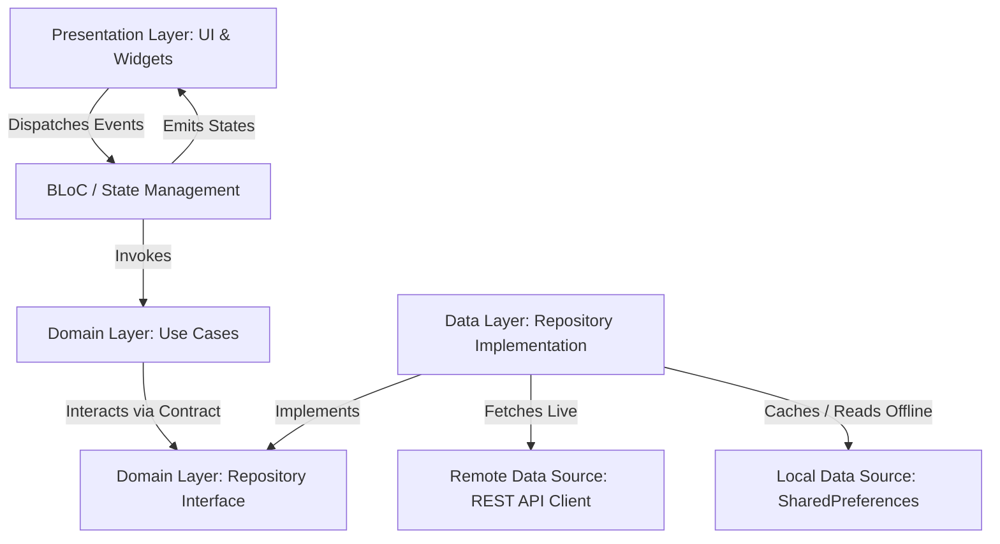

# 🛍️ PulseMarket — Production Flutter E-Commerce Application

[](https://flutter.dev)
[](https://dart.dev)
[](https://blog.cleancoder.com)
[](https://bloclibrary.dev)
[](https://fakestoreapi.com)
[](https://firebase.google.com)

A high-performance, responsive cross-platform Flutter application architected according to **Uncle Bob's Clean Architecture** principles, strict **BLoC (Business Logic Component)** pattern, **REST API integration with local caching**, and **Firebase Cloud Messaging (FCM)** push notification handling.

---

## 🌟 Key Features

- **🏛️ Strict Clean Architecture**: Decoupled into `Domain`, `Data`, and `Presentation` layers with Dependency Injection (`get_it`).
- **⚡ Reactive State Management (BLoC)**: Predictable, testable event-driven states (`ProductBloc`, `CartBloc`, `AuthBloc`, `ThemeBloc`) extending `Equatable`.
- **🌐 REST API Integration with Offline Caching**:
  - Live data fetching from `FakeStoreAPI` endpoints.
  - Automatic fallback to local cache (`SharedPreferences`) on network dropouts.
  - Custom error interception (`SocketException`, `TimeoutException`, HTTP 4xx/5xx).
- **🔔 Firebase Cloud Messaging (FCM)**:
  - Token generation & lifecycle handling.
  - Foreground notification banners & background message listeners.
  - Topic subscription routing (`flash_sales`, `order_updates`).
  - In-app interactive push notification simulator for instant recruiter demonstration.
- **🎨 Modern Material 3 UI / UX**:
  - Light & Dark mode support with persistent user preference.
  - Shimmer loading skeletons during asynchronous fetching.
  - Hero image transitions, smooth animations, and pull-to-refresh.
- **🧪 Unit & Widget Tested**: Full test coverage for BLoC transitions and cart calculations.

---

## 📐 Architecture Overview

The codebase is organized into modular feature domains following Clean Architecture:



---

## 📂 Project Directory Structure

```text
lib/
├── core/
│   ├── constants/        # API endpoints, design tokens, color palette
│   ├── di/               # Service Locator (GetIt) setup
│   ├── error/            # Failures & Exceptions hierarchy
│   ├── network/          # HTTP client, timeout, and response parsers
│   ├── theme/            # Material 3 light/dark themes & typography
│   └── usecase/          # Base UseCase interface
│
├── features/
│   ├── auth/             # Firebase Authentication & session caching
│   │   ├── data/         # UserModel, AuthRepositoryImpl
│   │   ├── domain/       # UserEntity, AuthRepository contract
│   │   └── presentation/ # AuthBloc, LoginPage
│   │
│   ├── products/         # Catalog, search, filtering & detail
│   │   ├── data/         # RemoteDataSource, LocalDataSource, ProductModel
│   │   ├── domain/       # Product entity, UseCases (GetProducts, Search)
│   │   └── presentation/ # ProductBloc, HomePage, ProductDetailPage, Widgets
│   │
│   ├── cart/             # Shopping cart, calculations, and checkout
│   │   ├── domain/       # CartItem entity
│   │   └── presentation/ # CartBloc, CartPage
│   │
│   ├── notifications/    # Firebase Cloud Messaging (FCM) service
│   │   ├── services/     # FCMNotificationService, token management
│   │   └── presentation/ # NotificationsPage, Push simulator
│   │
│   └── settings/         # Theme toggles & system diagnostics
│       └── presentation/ # ThemeBloc, ProfilePage
│
├── main_screen.dart      # Bottom navigation shell with dynamic badges
└── main.dart             # App entry point, MultiBlocProvider
```

---

## 🚀 Getting Started

### Prerequisites

- [Flutter SDK](https://flutter.dev/docs/get-started/install) (version 3.0.0 or higher)
- [Dart SDK](https://dart.dev) (version 3.0.0 or higher)
- Android Studio / VS Code with Flutter extension

### Installation

1. **Clone the repository**:
   ```bash
   git clone https://github.com/AbhishekKharat04/pulse_ecommerce_app.git
   cd pulse_ecommerce_app
   ```

2. **Install dependencies**:
   ```bash
   flutter pub get
   ```

3. **Run the application**:
   ```bash
   flutter run
   ```

4. **Execute unit tests**:
   ```bash
   flutter test
   ```

---

## 💡 Tech Stack & Libraries

| Category | Library | Purpose |
| :--- | :--- | :--- |
| **State Management** | `flutter_bloc`, `bloc`, `equatable` | Predictable event-to-state stream management |
| **Dependency Injection** | `get_it` | Decoupled Service Locator pattern |
| **Networking** | `http` | REST API communication with timeout handling |
| **Local Persistence** | `shared_preferences` | Offline product cache and auth session storage |
| **UI Components** | `cached_network_image`, `google_fonts` | Cached remote image loading and typography |
| **Testing** | `flutter_test`, `bloc_test`, `mocktail` | Unit testing of business logic |

---

## 📝 License

Distributed under the MIT License. See `LICENSE` for more information.
